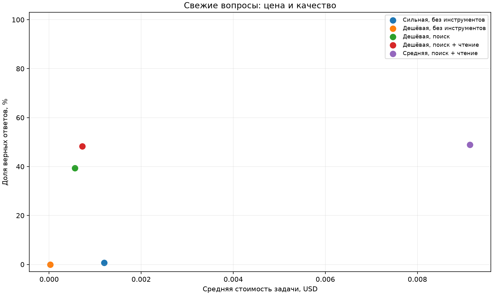

# ДЗ 1: свежие вопросы и агент с инструментами

**Состояние на 2026-10-30:** код, расширенный датасет и локальные проверки подготовлены.
Groq подключён; выполнена [диагностика одного вопроса в трёх профилях](reports/groq-check/README.md).
OpenRouter подключён: выполнены [пилот и проверка промпта](reports/openrouter-pilot/README.md).
Полный эксперимент **ещё не выполнен**; идёт исправление исходных вопросов по источникам.
Свежесть Sonnet ≤20%, итоговые цена/качество и два реальных провала пока не подтверждены.
Этот репозиторий нельзя считать окончательно готовым к сдаче до выполнения этих пунктов.
[План завершения](tasks/plan.md) и [проверяемый список задач](tasks/todo.md).

Решение обязательной части `homework01.pdf`, с архитектурой из `lecture01.pdf`,
`lecture02.pdf` и `lecture03.pdf`: HTTP API, Pydantic-схемы, цикл с инструментами,
ограничение шагов, наблюдения и учёт стоимости. Ноутбук семинара не был предоставлен,
поэтому реализация оформлена самостоятельными Python-скриптами.
Необязательная часть 2 с личной задачей и обсуждением с преподавателем не включена.

## Запуск без ключа

Проверено на Linux и Python 3.14. `python_exec` использует POSIX `resource`;
для Windows нужен WSL. Команды выполняются из корня репозитория:

```bash
python3 -m venv .venv
source .venv/bin/activate
python -m pip install -r requirements.txt
python -m pytest -q
python check_fresh.py data/fresh.jsonl
python -m freshqa schemas
python -m freshqa report
```

Тесты не обращаются к моделям и не требуют сети. Формат проверяется без ключа,
в отличие от исходного `check_fresh.py`, который импортировал модуль с обязательным
`OPENROUTER_API_KEY` даже без `--sonnet`.

В текущей рабочей копии пройден 151 тест. Предыдущая версия до добавления Groq
прошла 118 тестов в чистом локальном клоне с новым виртуальным окружением;
для обновлённой версии эту проверку ещё предстоит повторить.
[Подробности проверки](reports/verification.md).

## Датасет и сбор

В [data/fresh.jsonl](data/fresh.jsonl) **145 вопросов**: 125 записей стартового набора
с документированными правками и 20 новых вопросов по астрономическим результатам 2026 года.
Новые вопросы составлены по десяти официальным публикациям ESA/Hubble, ESA/Webb,
ESO, ALMA и Chandra; все 20 цитат проверены в текстах доступных страниц.
Дата события для открытий — дата публичного сообщения о результате.

- [Источники, метод, правки и ограничения](docs/dataset_sources.md).
- [20 добавленных вопросов](data/additions.jsonl).
- [Неизменённый исходный набор](data/fresh_2026.jsonl).
- [Проверка новых цитат](data/source_verification.json) и [аудит формата](data/dataset_audit.json).
- [Вывод локальной проверки](reports/format_check.txt).

Поля `sonnet_answer` и `agent_ok` в старых записях — метаданные предоставленного набора.
Они **не используются** как результаты этого решения. Исходный набор был специально
отобран по ошибкам сильной модели, что создаёт смещение отбора. Новые вопросы идут парами
по статьям и тоже не являются независимой случайной выборкой всех свежих событий.

## Реальный запуск после получения ключа

Если локального `.env` ещё нет, создайте его командой ниже. Если он уже есть,
сохраните существующие значения и добавьте `OPENROUTER_API_KEY` только в этом файле:

```bash
test -f .env || cp .env.example .env
```

Текущая реализация использует OpenRouter, как в материалах курса. Само задание
не требует этого провайдера: обязательна проверка на Sonnet 4.6. Прямой Claude API
или другой провайдер потребуют адаптации клиента и учёта стоимости.
Модели по умолчанию:

| Роль | Идентификатор |
|---|---|
| Дешёвая | `openai/gpt-4o-mini` |
| Средняя | `anthropic/claude-haiku-4.5` |
| Сильная | `anthropic/claude-sonnet-4.6` |

Идентификаторы настраиваются в `.env`; доступность моделей у провайдера проверяется
при настоящем вызове. Для зачёта свежести нужна именно Sonnet 4.6.
Цена берётся из фактического `usage.cost`, а не из устаревающей таблицы тарифов.

Сначала можно проверить один вопрос. Это платный smoke с отдельным каталогом:

```bash
python -m freshqa benchmark --limit 1 --configs cheap_search_read --budget-usd 0.10 --traces tmp/smoke-traces --out tmp/smoke-report
```

Затем проверка свежести на **всех** вопросах и остальные четыре обязательные строки:

```bash
python check_fresh.py data/fresh.jsonl --sonnet > reports/sonnet_check.txt
python -m freshqa benchmark --resume --budget-usd 5
```

Второй запуск использует уже сохранённые ответы Sonnet и не оплачивает их заново.
Можно сразу выполнить `python -m freshqa benchmark --budget-usd 5`: он включает все пять
строк; после этого `check_fresh.py --sonnet --resume` напечатает проверку без новых вызовов.
Если критерий свежести не пройден, замените/уточните угаданные вопросы и выполните
**новый** полный эксперимент в новом каталоге. Подгонять только ответ без проверки источника нельзя.

Бонусные конфигурации реализованы, но их ценность пока не измерена:

```bash
python -m freshqa benchmark --resume --bonuses --budget-usd 5
```

Второй источник — DuckDuckGo HTML. При проверке 2026-10-29 он вернул антибот-проверку,
которую инструмент честно записывает как ошибку. Бонус за второй источник пока не заявляется;
для полноценного сравнения нужна доступная выдача. Основные Wikipedia-поиск и чтение
полной статьи, а также чтение официальной страницы ESA/Hubble проверены живыми HTTP-запросами.

## Устройство агента

| Файл | Что делает |
|---|---|
| `freshqa/tools.py` | Реестр инструментов, Pydantic-схемы и обработка ошибок |
| `freshqa/client.py` | OpenRouter Chat Completions и учёт реальных списаний |
| `freshqa/agent.py` | Цикл, наблюдения, детектор повторов, финальный ответ |
| `freshqa/dataset.py` | Валидация и детерминированная оценка ответов |
| `freshqa/experiment.py` | Конфигурации, каскад, JSON-трейсы и продолжение прогона |
| `freshqa/reporting.py` | CSV/JSON/Markdown, таблица свежести, график, кандидаты провалов |
| `original/` | Предоставленные скрипты без изменения; рабочий запуск их не импортирует |

Инструменты:

- `web_search(query, language)` ищет в английской или русской Википедии и возвращает сниппеты.
- `page_find(title, keywords, language, url)` загружает полный текст статьи через
  `prop=extracts` **без** `exintro`, находит фрагменты по ключевым словам; поддерживает
  прямой публичный HTML/текстовый URL. Для перенаправлений нужно указывать конечный URL.
- `calculator(expression)` считает арифметику с проверкой AST, без произвольного `eval`.
- `python_exec(code)` исполняет небольшое числовое подмножество Python в отдельном процессе:
  только разрешённые AST-узлы и функции, без импортов/атрибутов/строк, с ограничениями CPU,
  памяти, времени и вывода. Это не полноценная среда исполнения произвольного Python.
- `web_search_extra(query)` — опциональный второй поисковик с явной ошибкой при блокировке.

У каждого инструмента есть тесты нормального входа, пустого результата и ошибки.
Произвольные публичные URL проверяются на приватные адреса; соединение привязано к проверенному
IP с проверкой TLS, редиректы отключены. Тексты сайтов считаются недоверенными данными.

`max_steps=6` ограничивает число LLM-вызовов на вопрос. Последний вызов резервируется
для ответа без инструментов. Повтор одинакового имени и канонических аргументов
не исполняется второй раз и запускает мягкое завершение. На одном шаге выполняется
не более четырёх инструментов. Базовые модели без инструментов вызываются ровно один раз.
В строке «только поиск» остаются калькулятор и Python, но единственный источник внешних
фактов — поисковые сниппеты; чтение страницы отсутствует.

Каскад запускает дешёвую модель с расширенными инструментами и передаёт исходный вопрос
средней, только если ответ `unknown` или агент завершён ограничителем. Эталон не участвует
в решении об эскалации. Стоимость, шаги и время двух стадий суммируются; каждая стадия
имеет собственный `max_steps`. Ошибка API/бюджета не вызывает эскалацию.

## Честность оценки и расходов

В модель передаётся только `question`: поля `answer`, `evidence`, `url`, исторические
ответы и правильность в контекст не добавляются. В трейс эталон попадает после inference.

Метрика сохраняет идею семинара: нормализованный эталон должен содержаться в ответе.
Изменения относительно предоставленного `normalize` описаны явно:

1. Оценивается часть после `FINAL:`, а не промежуточный текст.
2. Слова сравниваются по границам; числовой ответ `12` не совпадает с `112` или `12.5`.
3. Для дат поддерживаются `15 March`, `March 15` и ISO-дата. Если модель указала год,
   он сверяется с годом эталона или известным годом источника. Для полного эталона с годом
   отсутствие года не засчитывается.
4. Разделители тысяч (запятая/пробел) нормализуются. Явные проверенные `answer_aliases`
   допустимы; для `fresh-142` это `2.5 days` вместо `two and a half`.
5. Проверка формата требует **буквального** вхождения основного ответа в цитату.

Это всё ещё приближённая метрика: она не понимает отрицания и все синонимы.
В `reports/failure_candidates.md` автоматически выбираются до двух ошибочных трейсов
для ручного разбора. До сдачи прочитайте их и сохраните окончательные причины в
`reports/failures.md`; автоматическая классификация сама по себе не является разбором.

Цена задачи = сумма всех известных списаний / число обработанных вопросов.
Цена верного ответа = **все** списания, включая неверные ответы, / число верных.
При нуле верных эта величина не определена. Средние шаги — LLM-запросы;
время включает работу модели и инструментов. Инструменты не используют платные API.
В график и итоговый вывод допускаются только полные конфигурации с известной стоимостью.

Лимит расходов проверяется **между запросами**: последний ответ может пересечь порог.
Жёсткое ограничение задаётся лимитом ключа у провайдера. Каждый новый каталог — отдельный
учёт; суммы разных каталогов нужно учитывать совместно. Автоповторов платных POST нет.
Неизвестный `usage.cost` или сетевой обрыв блокируют дальнейшие запросы.

`--resume` требует неизменных данных, кода, моделей и max_steps, не уменьшает уже
учтённые расходы и пропускает сохранённые задачи. Перед запросом создаётся `inflight.json`.
Если процесс прерван, этот маркер блокирует продолжение: сначала нужно сверить расходы
в OpenRouter и восстановить учёт, а не просто удалять маркер и повторять запрос.
Трейсы с API-ошибками сохраняются, но не превращают неполный эксперимент в успешный.

## Результаты

Блок ниже обновляется командой `python -m freshqa report` и после реального эксперимента.
Также создаются [CSV](reports/report.csv), [JSON](reports/report.json),
[таблица свежести](reports/freshness.json) и [отдельный отчёт](reports/report.md).

<!-- RESULTS:START -->

## Результаты эксперимента

Числа рассчитываются только из реальных трейсов. `—` означает отсутствие замера, а не ноль.

| Конфигурация | Завершено | Верных | $/задачу | $/верный | Шагов | Секунд |
|---|---:|---:|---:|---:|---:|---:|
| Сильная, без инструментов | 0/145 | — | — | — | — | — |
| Дешёвая, без инструментов | 0/145 | — | — | — | — | — |
| Дешёвая, поиск | 0/145 | — | — | — | — | — |
| Дешёвая, поиск + чтение | 0/145 | — | — | — | — | — |
| Средняя, поиск + чтение | 0/145 | — | — | — | — | — |
| Дешёвая, Wiki + второй поиск + чтение | 0/145 | — | — | — | — | — |
| Каскад: дешёвая → средняя | 0/145 | — | — | — | — | — |

Незавершённые строки описывают только обработанные вопросы и не подходят для итогового сравнения.
При нуле верных $/верный не определена. При неизвестном списании цена не рассчитывается.

### Проверка свежести

| Модель | Проверено | Верных | Критерий ≤20% |
|---|---:|---:|---|
| anthropic/claude-sonnet-4.6 | 0/145 | — | не проверен |

Угаданные id: нет результатов / нет угаданных.



### Вывод

Полного прогона пяти обязательных конфигураций пока нет. Тезис курса не проверен; вывод о превосходстве дешёвого агента делать нельзя. Нужен OPENROUTER_API_KEY и полный запуск.

<!-- RESULTS:END -->

## Что осталось перед сдачей

1. Завершить исправление исходных вопросов по результатам проверки источников.
2. Проверить свежесть ≤20%, при необходимости доработать набор, затем выполнить
   полный эксперимент на неизменных данных и коде; приложить вывод `--sonnet`.
3. Разобрать два реальных провала, дополнить вывод объяснением наблюдаемого результата.
4. Создать удалённый Git-репозиторий, загрузить код, данные и реальные трейсы; сдаётся его ссылка.

`.env` исключён из Git, `.env.example` содержит только пустые поля ключей. Отправка работы
в чат курса не выполнялась. Ветки после завершения сохраняются.

## Технические источники

Формат HTTP-запроса и function calling сверены с
[OpenRouter API](https://openrouter.ai/docs/api_reference/overview).
Учёт фактической стоимости опирается на
[Usage Accounting](https://openrouter.ai/docs/cookbook/administration/usage-accounting).
Полный текст Википедии получается по
[MediaWiki TextExtracts](https://www.mediawiki.org/wiki/Extension:TextExtracts#API).
Фактические источники новых вопросов перечислены отдельно в [документации датасета](docs/dataset_sources.md).
