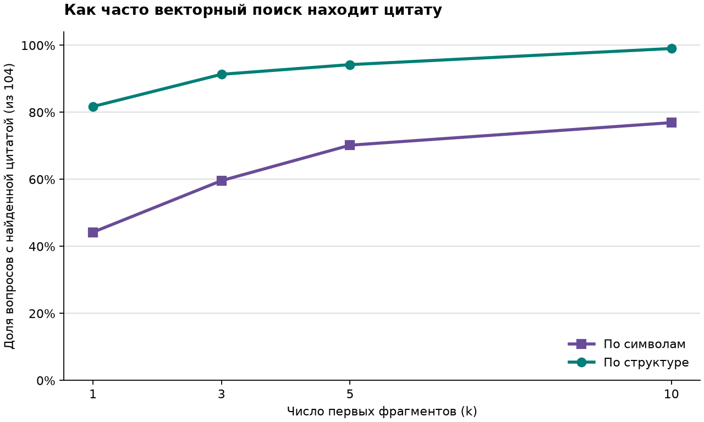
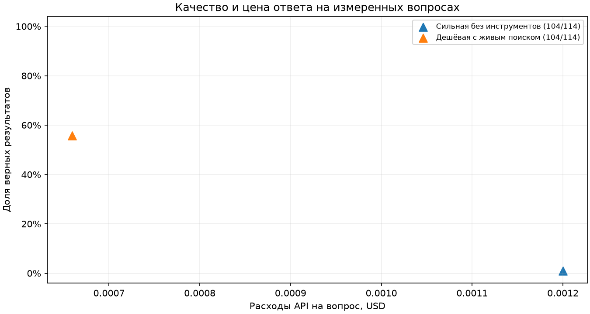
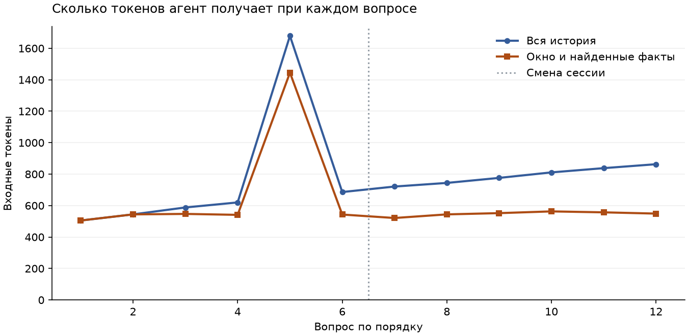

# ДЗ‑2. База знаний и память агента

В ДЗ‑1 агент искал сведения в интернете. Здесь первый эксперимент проверяет, сможет ли поиск по локальному снимку найти фрагмент с ответом. Для поиска можно использовать только текст вопроса. Эталонный ответ и цитата нужны при оценке результата.

## Воспроизвести первый этап

Выполните три команды из корня репозитория.

```bash
python3 -m hw2.prepare_corpus
python3 -m hw2.chunk_corpus
python3 -m hw2.lexical_baseline
```

Все три команды используют стандартную библиотеку Python. Первая сверяет вопросы со снимком. Если снимка нет, она скачивает статьи из английской Википедии. Ключ модели не нужен. Для сознательного обновления снимка предусмотрена команда `python3 -m hw2.prepare_corpus --refresh`. После обновления заново проверьте десять вопросов без ответа, нарезку и все метрики.

### Как собрана выборка

В [итоговой выборке ДЗ‑1](../data/fresh.jsonl) 145 вопросов. 104 из них ссылаются на 30 страниц английской Википедии. Для этого эксперимента выбрана Wikipedia, поскольку в её летописях события разделены строками и есть явные заголовки. Остальные 41 вопрос относятся к другим сайтам.

- [Снимок статей](data/corpus.jsonl) содержит тексты MediaWiki с разметкой заголовков, названия и URL. В корпус входят только статьи.
- [Вопросы с ответами](data/questions.jsonl) сохраняют исходные ID, ответы, цитаты и ссылки ДЗ‑1. Для допуска требуется совпадение **всей** цитаты на странице источника после нормализации Unicode, регистра, пробелов и пунктуации. При несовпадении скрипт печатает ID.
- [Десять вопросов без ответа](data/unanswerable.jsonl) проверяют, умеет ли агент отказаться при нехватке сведений. Они идут в отдельную оценку отказов.

Пример для демонстрации отказа — `unknown-9`. В снимке описано, как из-за наводнения рейсы перенаправили из Найроби в Момбасу. Пользователь спрашивает, **сколько** рейсов перенаправили. В соответствующих фрагментах число отсутствует, поэтому ожидаемый ответ — `unknown`.

### Как сравнивать поиск

Символьная нарезка делит текст на окна по 600 символов с перекрытием 100. Структурная сохраняет строку хронологии или абзац вместе, чтобы описание события обычно помещалось в один фрагмент. Строки длиннее 600 символов делятся по пробелам. У фрагмента есть ID, статья, URL, раздел и границы в тексте снимка.

Для каждого вопроса с ответом известна цитата `evidence`. Успешный поиск означает, что хотя бы один из первых *k* фрагментов содержит полную нормализованную цитату и относится к её URL. Здесь `recall@k` — доля таких вопросов среди **всех** вопросов с ответом. Если нарезка разорвала цитату и целого фрагмента нет, вопрос остаётся в знаменателе. Вопросы без ответа оцениваются отдельно.

### Результат на локальном снимке от 5 ноября 2026 года

В 30 статьях нашлись полные цитаты всех 104 выбранных вопросов. Таблица показывает число вопросов из 104, для которых BM25 нашёл цитату на нужной странице. Баллы BM25 вычисляются по тексту фрагмента.

| Нарезка | Фрагментов | Цитата целиком хотя бы в одном фрагменте | Первое место | Первые 3 | Первые 5 | Первые 10 |
|---|---:|---:|---:|---:|---:|---:|
| По символам | 1 901 | 94 | 79 | 92 | 93 | 93 |
| По структуре | 8 223 | 104 | 95 | 101 | 103 | 103 |

Например, вопрос `fresh-100` спрашивает, на какое максимальное расстояние от Земли удалился экипаж Artemis II. В символьной нарезке граница окна разделила цитату. В структурной нарезке сохранилась запись события из раздела *Events / April*, и BM25 поставил её на первое место. Переход от пяти к десяти фрагментам здесь не дал новых попаданий.

## Векторный и гибридный поиск

**Для генерации выбраны структурная нарезка, гибрид RRF и три фрагмента.** На 104 вопросах этот вариант нашёл цитату 103 раза. Увеличение выдачи гибрида до пяти или десяти фрагментов сохранило те же 103 попадания. Точность готовых ответов и стоимость измерены в [сравнении пяти конфигураций](#сравнение-пяти-конфигураций). [Выполненный ноутбук](retrieval.ipynb) · [результат по каждому вопросу](results/retrieval.json).

| Нарезка | Поиск | Первое место | Первые 3 | Первые 5 | Первые 10 |
|---|---|---:|---:|---:|---:|
| По символам | Вектор | 46 | 62 | 73 | 80 |
| По символам | BM25 | 79 | 92 | 93 | 93 |
| По символам | Гибрид RRF | 64 | 84 | 88 | 91 |
| По структуре | Вектор | 85 | 95 | 98 | 103 |
| По структуре | BM25 | 95 | 101 | 103 | 103 |
| По структуре | Гибрид RRF | 95 | **103** | 103 | 103 |



У вопроса `fresh-39` о месте железнодорожного столкновения в Испании оба отдельных метода поставили нужную запись на четвёртое место. При объединении она поднялась на второе. Для `fresh-88` о происшествии с лодкой в Японии вышло наоборот. Векторный поиск нашёл цитату на третьем месте, у BM25 она оказалась за пределами первых 100 результатов, а у гибрида — на 30-м. Это единственный пропуск гибрида при *k* = 3 на структурной нарезке.

### Как выполнен замер

- На устройстве вычислены 384-мерные векторы с помощью английской MiniLM. Для вопросов и фрагментов использовался только их текст. Модель и токенизатор закреплены по ревизии и контрольным суммам. В `tmp/hw2-embeddings/` хранятся веса и SQLite-кэш по тексту, его роли, модели и настройкам обработки. [Карточка модели](https://huggingface.co/sentence-transformers/all-MiniLM-L6-v2) · [версия ONNX](https://huggingface.co/Xenova/all-MiniLM-L6-v2/tree/751bff37182d3f1213fa05d7196b954e230abad9).
- Milvus Standalone 2.5.27 запущен локально в Docker. Для каждой нарезки создана отдельная коллекция с индексом `FLAT` и косинусным сходством. Имена коллекций учитывают содержимое фрагментов и эмбеддинги. [Compose проекта](docker-compose.yml) адаптирован из [официального сценария Standalone](https://github.com/milvus-io/milvus/blob/v2.5.27/scripts/standalone_embed.sh).
- Гибрид берёт по 100 результатов BM25 и векторного поиска. Для каждого фрагмента он складывает `1 / (60 + позиция)` за каждый список, в котором этот фрагмент встретился. При равной сумме используется сортировка по ID. [Описание RRF](https://milvus.io/docs/reranking.md).
- В отдельной демонстрации пользователь ограничил запрос статьёй *2026 in Canada* и спросил, что Statistics Canada объявила о рабочих местах. Все три результата прошли фильтр по статье. Первой вернулась запись от 13 января о 850 сокращениях. Для расчёта таблицы поиск шёл по всему корпусу.

### Повторить замер

После подготовки корпуса и двух нарезок выполните из корня репозитория следующие команды. Проверено на Linux с Python 3.12.

```bash
uv venv --python 3.12 hw2/.venv
uv pip install --python hw2/.venv/bin/python -r hw2/requirements.txt
docker compose -f hw2/docker-compose.yml up -d --wait
hw2/.venv/bin/python -m hw2.run_retrieval
hw2/.venv/bin/python -m pytest -q tests/test_hw2*.py
```

Первому запуску нужен интернет для публичных пакетов, образа Docker и весов модели. Повторный замер использует локальную базу и кэш. Сервер слушает `127.0.0.1:19530`. Данные хранятся в именованном томе Docker. Чтобы остановить его с сохранением коллекций, выполните `docker compose -f hw2/docker-compose.yml stop`. Без Docker тот же код можно запустить с `--uri tmp/hw2-milvus.db --output-dir tmp/retrieval-lite`.

## Ответ по найденным фрагментам

У агента ДЗ‑1 появился инструмент `knowledge_base(query, page=None)`. По запросу он возвращает до трёх структурных фрагментов в порядке RRF. В каждом есть `id`, текст, статья, раздел и URL. Необязательный `page` ограничивает оба поиска точным названием статьи до отбора первых 100 кандидатов. Агент получает [схему инструмента](../freshqa/tools.py) через `ToolRegistry(knowledge_search=kb.search)` и сам решает, когда его вызвать.

В режиме обязательного RAG функция [`rag_answer`](rag.py) сначала ищет фрагменты, затем передаёт их вместе с вопросом клиенту модели. Число, имя или другой короткий ответ должны дословно входить в подтверждающую цитату из указанного фрагмента. Ссылка берётся из метаданных корпуса. Функция сохраняет ID найденных фрагментов и возвращённые клиентом сведения о токенах и стоимости.

| Случай | Что возвращает `rag_answer` |
|---|---|
| Ответ и цитата проходят проверку | `answered` с ответом, цитатой и ссылкой |
| Фрагменты найдены, модель сообщает о нехватке данных | `unknown`, статус `insufficient_evidence` |
| Поиск вернул пустую выдачу | `unknown`, статус `no_hits`, вызов модели пропускается |
| Неизвестный ID, подменённая цитата или ошибочный формат | `unknown`, статус `invalid_output` |

### Проверить без ключа

Запустите ранее подготовленный Milvus и выполните из корня репозитория следующие команды.

```bash
uv pip install --python hw2/.venv/bin/python -r hw2/requirements.txt
hw2/.venv/bin/python -m hw2.demo_rag
hw2/.venv/bin/python -m pytest -q tests/test_hw2*.py tests/test_agent.py
```

Два вопроса заданы локальной Qwen2.5-0.5B-Instruct на CPU с тремя реальными фрагментами из Milvus. Модель получила текст вопроса и найденные фрагменты. В демонстрации команда заново выполняет поиск и прогоняет записанные ответы через `rag_answer`, сверяя порядок ID с исходным прогоном. [Ответы модели, токены и параметры запуска](results/rag_smoke.json).

| Вопрос | Ответ локальной Qwen | Проверка |
|---|---|---|
| Сколько сокращений объявила Statistics Canada? | **850** | Цитата дословно входит в статью *2026 in Canada*, ссылка взята из её метаданных. |
| Сколько из этих сокращений пришлось на ИТ? | **unknown** | В ответе модель также указала ID фрагмента, где есть только общая численность. |
| Поиск с фильтром *2026 in Canada* | Три фрагмента | Все три принадлежат выбранной статье. |

В первом прогоне валидатор пометил второй ответ как ошибку формата из-за дополнительного ID. Теперь явный отказ может содержать ID просмотренного фрагмента. Проверка на сохранённом ответе дала `insufficient_evidence`. Пользователю возвращается `unknown` без ссылки. Чужой ID по-прежнему приводит к `invalid_output`. Отдельный тест проводит вызов инструмента через агента ДЗ‑1.

## Сравнение пяти конфигураций

На 104 вопросах с известным ответом обязательный поиск по локальной базе поднял результат GPT‑4o mini с **58 до 94 верных фактов** по сравнению с живым поиском в Wikipedia. Расходы API на верный факт снизились в **11,2 раза**. Если сопоставить ответы по ID, RAG исправил 42 прежние ошибки и дал ошибку на шести вопросах, на которые раньше был верный ответ. [Выполненный ноутбук](benchmark.ipynb) · [отчёт с таблицами](results/benchmark/report.md).

| Режим | Верный факт, из 104 | Верный отказ, из 10 | Ложный отказ, из 104 | USD за верный факт |
|---|---:|---:|---:|---:|
| Claude Sonnet 4.6 без инструментов | 1 | 10 | 102 | 0,124782 |
| GPT‑4o mini с живым поиском и чтением | 58 | 9 | 33 | 0,001182 |
| GPT‑4o mini с обязательным RAG | **94** | **10** | 1 | **0,000106** |
| GPT‑4o mini сам решает, вызывать ли базу | 85 | 10 | 6 | 0,000232 |
| Claude Haiku 4.5 с обязательным RAG | 1 | 0 | 0 | 0,090092 |

В столбце цены сумма списаний за 104 вопроса с известным ответом делится на число верных фактов. На графике учтены все 114 вопросов, включая десять проверок отказа. Слева вверху находятся режимы с меньшими расходами на вопрос и большей долей верных результатов. Локальное построение и хранение индекса в цену API не входят.



### Где теряются ответы

- **Поиск, один вопрос.** В `fresh-88` спрашивали, где в Японии опрокинулись лодки. Ожидалось *Henoko, Okinawa Prefecture*. Векторный поиск поставил нужный фрагмент на третье место, а после объединения с BM25 он оказался на 30-м. Модель получила три других фрагмента и вернула `unknown`. Для следующего эксперимента можно зарезервировать место в выдаче для результата векторного поиска и заново измерить recall на всех вопросах. [Позиции фрагментов](results/retrieval.json).
- **Проверка ответа, девять вопросов.** Во всех девяти случаях правильная цитата попала в контекст GPT‑4o mini, но ответ получил статус `invalid_output`. Например, в отдельном повторе `fresh-120` модель правильно назвала *Operation Southern Spear*, а часть цитаты заменила многоточием. Валидатор требует дословный отрывок. Для такого случая можно просить короткую непрерывную цитату и приводить пример допустимого ответа. [Записанный ответ модели](results/benchmark/format_diagnostic.json).
- **Совместимость Haiku с форматом.** Валидатор отклонил 113 из 114 результатов этой конфигурации. На том же вопросе `fresh-120` в отдельном повторе Haiku вернула правильный факт и точную цитату, обернув JSON в блок Markdown. При локальном удалении обёртки ответ прошёл все проверки. Установить причины остальных отклонений по одному повтору нельзя. [Ответ до проверки и результат после снятия обёртки](results/benchmark/format_diagnostic.json).

### Измерения и расходы

Всего собрано 570 результатов. Для двух исходных режимов взяты 208 ответов из ДЗ‑1 с совпадающими ID и текстами вопросов. При импорте проверены модель, инструменты, завершение ответа и суммы по вызовам. Остальные 362 результата получены в этом прогоне. Вопросы для проверки отказов новые для всех пяти режимов. В обоих режимах с обязательным RAG модель видит вопрос и три найденных фрагмента. Эталоны используются при оценке. [Результаты по вопросам](results/benchmark/report.json).

Новые списания OpenRouter составили **0,15548250 USD** из разрешённого 1 USD. Основной эксперимент стоил 0,15451085 USD, два дополнительных диагностических запроса — 0,00097165 USD. Диагностика вынесена за пределы основной выборки. Сумма совпала с изменением счётчика OpenRouter для ключа. Исторические 0,19336155 USD учитываются только при сравнении стоимости режимов. [Сверка расходов](results/benchmark/expenses.json).

После установки зависимостей выполните из корня проекта команду ниже. Она восстановит все 570 результатов из архива ДЗ‑1 и [снимка новых измерений](results/benchmark/measured.json.gz), пересчитает оценки и построит график. Ключ, подключение к сети и запущенный Milvus для этого не требуются.

```bash
hw2/.venv/bin/python -m hw2.run_benchmark
```

## Память между сессиями

В демонстрации вымышленный пользователь составляет карточки пеших маршрутов. Агент умеет запоминать день напоминаний, единицы расстояния и название проекта. Во время разговора он по-прежнему может вызвать инструмент базы знаний из шага 3. [Выполненный ноутбук](memory.ipynb) · [вопросы, ответы, найденные факты и замеры по шагам](results/memory/demo.json).

**Что получает модель.** Каждая реплика с отметкой UTC, ID пользователя и ID сессии записывается в локальный JSONL. Для ответа берётся последняя пара реплик текущей сессии и до двух фактов из Milvus по смысловой близости к вопросу. В начале новой сессии окно пустое. При завершении сессии из журнала отбираются английские утверждения пользователя от первого лица (`I`, `my`, `we`, `our`). Модель извлекает значения, а программа проверяет каждое по дословной цитате. Такой отбор задаёт границы этой учебной демонстрации. Проверенные факты записываются в отдельную коллекцию `freshqa_memory_v1`. У пары «пользователь, тип факта» один ID, поэтому исправление обновляет ту же запись. [Код агента](memory_agent.py) · [журнал и коллекция](memory_store.py).

**Как сравнивались расходы.** Двенадцать вопросов заданы в одном порядке. В контрольном режиме агент получает всю накопленную переписку, включая первую сессию. Предыдущие ответы для обоих режимов взяты из одного фактически состоявшегося разговора с окном. Поэтому различие в формулировках прошлых ответов не меняет входные данные для сравнения. График учитывает все вызовы модели для ответа на очередной вопрос, в том числе после вызова инструмента. В суммарную цену варианта с памятью дополнительно входят два извлечения фактов. [Замеры по вопросам](results/memory/comparison.json).



**Что запомнил агент.** После первой сессии в Milvus лежали `reminder_day = Tuesday` и `distance_unit = kilometers`. В начале второй сессии агент ответил *Tuesday* на вопрос о напоминании и *kilometers* на вопрос о расстояниях. Когда пользователь перенёс напоминания на пятницу, агент тут же ответил *Friday*. Через один промежуточный вопрос исправление вышло из окна, и агент снова назвал *Tuesday*. При завершении сессии экстрактор записал *Friday*. Повторный поиск в Milvus вернул единственное действующее значение дня — *Friday*. Для исправлений, которые должны действовать внутри длинной сессии, обновлять факт нужно раньше.

| Режим на 12 вопросах | Входные токены | Выходные токены | Списания API, USD | Условная цена, USD |
|---|---:|---:|---:|---:|
| Вся история | 9 375 | 152 | 0 | 0,00149745 |
| Окно и факты, только ответы | 7 411 | 110 | 0 | 0,00117765 |
| Два извлечения фактов | 262 | 31 | 0 | 0,00005790 |
| Окно и факты, включая извлечение | **7 673** | **141** | **0** | **0,00123555** |

На этом диалоге окно с фактами сократило число входных токенов на **1 702 (18,2%)**, даже с учётом извлечения. Обе конфигурации работали локально на CPU, поэтому фактические списания API составили 0 USD. Для сравнения по единому тарифу последний столбец пересчитывает измеренные токены Qwen по условным ставкам 0,15 USD за миллион входных и 0,60 USD за миллион выходных. Разница по такой оценке — **17,5%**. Расходы на электроэнергию не измерялись.

### Как проверить

Из корня проекта выполните команды ниже. Первая проверяет сохранённый прогон и пересобирает таблицу и график без ключа и сервера модели. Тесты используют временную базу Milvus Lite и детерминированные векторы для проверки пустой памяти, поиска, замены значения и изоляции пользователей.

```bash
hw2/.venv/bin/python -m hw2.demo_memory
hw2/.venv/bin/python -m pytest -q tests/test_hw2_memory*.py
```

Для нового измерения понадобятся нарезанный корпус, работающий Milvus и локальная модель с поддержкой инструментов. В эксперименте использована Qwen2.5‑1.5B‑Instruct Q4_K_M на CPU в llama.cpp b5996. Файл шаблона — значение поля `chat_template` из конфигурации токенизатора. [Веса модели](https://huggingface.co/Qwen/Qwen2.5-1.5B-Instruct-GGUF/blob/91cad51170dc346986eccefdc2dd33a9da36ead9/qwen2.5-1.5b-instruct-q4_k_m.gguf) · [конфигурация токенизатора](https://huggingface.co/Qwen/Qwen2.5-1.5B-Instruct/blob/989aa7980e4cf806f80c7fef2b1adb7bc71aa306/tokenizer_config.json) · [версия llama.cpp](https://github.com/ggml-org/llama.cpp/releases/tag/b5996).

Ниже команды для двух терминалов после загрузки этих файлов. Отдельные каталоги в `tmp` сохраняют исходный отчёт. Из каталога запуска уже начатый эксперимент продолжается по квитанциям с совпадающим хешем запроса.

```bash
python3 -c 'import json; from pathlib import Path; Path("tmp/hw2-chat.jinja").write_text(json.loads(Path("tokenizer_config.json").read_text())["chat_template"])'
llama-server --host 127.0.0.1 --port 17861 --model qwen2.5-1.5b-instruct-q4_k_m.gguf \
  --alias Qwen2.5-1.5B-Instruct-Q4_K_M --jinja --chat-template-file tmp/hw2-chat.jinja \
  --threads 4 --ctx-size 8192 --parallel 1 --seed 1 --no-webui
```

```bash
hw2/.venv/bin/python -m hw2.demo_memory --local-server http://127.0.0.1:17861 \
  --run-dir tmp/memory-repeat --out tmp/memory-repeat/results
```
