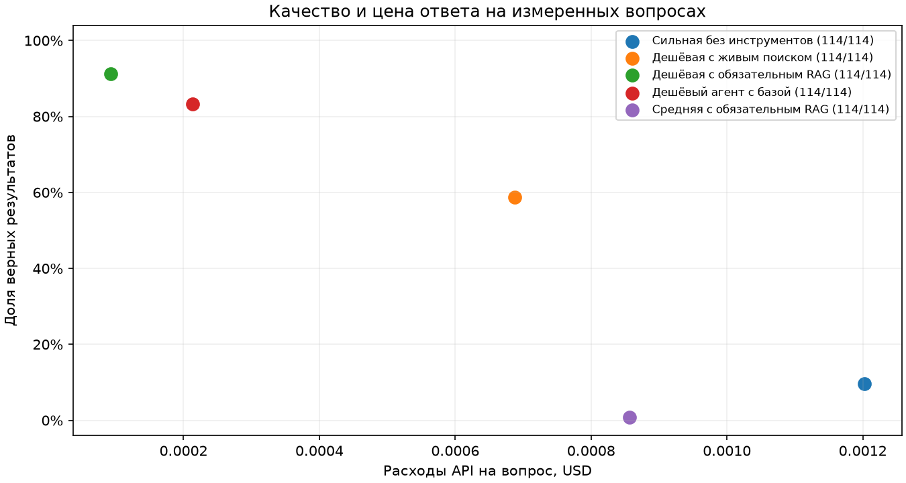

# Ответы агента и расходы

Вопросов с ответом — 104, вопросов для проверки отказа — 10.

| Конфигурация | Покрытие | Измерено | Верных | Точность | USD/вопрос | USD/верный результат |
|---|---|---:|---:|---:|---:|---:|
| Сильная без инструментов | полное | 114/114 | 11/114 | 9.6% | 0.001202 | 0.012457 |
| Дешёвая с живым поиском | полное | 114/114 | 67/114 | 58.8% | 0.000687 | 0.001169 |
| Дешёвая с обязательным RAG | полное | 114/114 | 104/114 | 91.2% | 0.000093 | 0.000102 |
| Дешёвый агент с базой | полное | 114/114 | 95/114 | 83.3% | 0.000213 | 0.000255 |
| Средняя с обязательным RAG | полное | 114/114 | 1/114 | 0.9% | 0.000857 | 0.097652 |

Для каждой строки знаменатель точности и цены вопроса — число обработанных вопросов. Технические ошибки и отклонённый формат учитываются в числе обработанных и дают ноль верных. На вопросах без ответа засчитывается явный отказ или пустая выдача с ответом unknown. Цена верного результата равна сумме подтверждённых расходов по строке, делённой на число верных. Прочерк означает отсутствие данных, неизвестную цену либо ноль верных результатов.

При разном покрытии цифры относятся к разным подвыборкам. На графике треугольники обозначают частичные строки, круги — полные.

## Отказы на обработанных вопросах

| Конфигурация | Верных ответов на положительных | Отказ модели на отрицательных | Ложный отказ модели на положительных | Пустая выдача (+ / −) | Всего ложных отказов системы | Ошибка формата / выполнения |
|---|---:|---:|---:|---:|---:|---:|
| Сильная без инструментов | 1/104 | 10/10 | 102/104 | 0 / 0 | 102/104 | 0 / 0 |
| Дешёвая с живым поиском | 58/104 | 9/10 | 33/104 | 0 / 0 | 33/104 | 0 / 0 |
| Дешёвая с обязательным RAG | 94/104 | 10/10 | 1/104 | 0 / 0 | 1/104 | 9 / 0 |
| Дешёвый агент с базой | 85/104 | 10/10 | 6/104 | 0 / 0 | 6/104 | 0 / 0 |
| Средняя с обязательным RAG | 1/104 | 0/10 | 0/104 | 0 / 0 | 0/104 | 113 / 0 |

## Происхождение расходов

| Конфигурация | Архив ДЗ‑1, ответов / USD | Новые результаты ДЗ‑2, ответов / USD | Неизвестных цен |
|---|---:|---:|---:|
| Сильная без инструментов | 104 / 0.124782 | 10 / 0.012243 | 0 |
| Дешёвая с живым поиском | 104 / 0.068580 | 10 / 0.009753 | 0 |
| Дешёвая с обязательным RAG | — | 114 / 0.010594 | 0 |
| Дешёвый агент с базой | — | 114 / 0.024269 | 0 |
| Средняя с обязательным RAG | — | 114 / 0.097652 | 0 |

Архивные расходы учитываются один раз при сравнении конфигураций. Столбцы происхождения суммируют только известные списания. При неизвестной цене хотя бы одного вызова средние цены всей строки оставлены пустыми.

## Цена верного факта на вопросах ДЗ‑1

Размер общей выборки вопросов с известным ответом — 104. Для каждого режима делим сумму списаний API на этих вопросах, включая расходы на ошибки и отказы, на число верных фактов. Локальные вычисления и хранение данных в сумму списаний API не входят.

| Конфигурация | Измерено на общей выборке | Верных фактов | Расходы API, USD | USD/верный факт |
|---|---:|---:|---:|---:|
| Сильная без инструментов | 104/104 | 1/104 | 0.124782 | 0.124782 |
| Дешёвая с живым поиском | 104/104 | 58/104 | 0.068580 | 0.001182 |
| Дешёвая с обязательным RAG | 104/104 | 94/104 | 0.009957 | 0.000106 |
| Дешёвый агент с базой | 104/104 | 85/104 | 0.019692 | 0.000232 |
| Средняя с обязательным RAG | 104/104 | 1/104 | 0.090092 | 0.090092 |

При обязательном RAG расходы API на верный факт у той же дешёвой модели ниже, чем при живом поиске ДЗ‑1 (USD 0.000106 против 0.001182). Число верных фактов — 94 против 58 из 104.

## Ошибки на вопросах с ответом

Лучший полный результат по точности у «Дешёвая с обязательным RAG». При равенстве выбран меньший расход на верный результат.

### Цитата была в контексте (число ошибок — 9)

Пример fresh-120. What operation was involved in the United States seizing tankers in January 2026?

Ожидалось **Operation Southern Spear**, получено **unknown**. Эталонная цитата — «January 7 – The United States seizes two shadow fleet tankers, including one under a Russian flag, in the United States oil blockade during Operation Southern Spear.». [Источник](https://en.wikipedia.org/wiki/2026).
Фрагмент из выдачи — «January 7 – The United States seizes two shadow fleet tankers, including one under a Russian flag, in the United States oil blockade during Operation Southern Spear.».
Следующая проверка — дать генератору найденный фрагмент отдельно и проверить, совпадают ли предмет вопроса, единицы и даты в ответе и цитате.

### Цитата отсутствовала в контексте (число ошибок — 1)

Пример fresh-88. What was the location of the boat capsizing in Japan in March 2026?

Ожидалось **Henoko, Okinawa Prefecture**, получено **unknown**. Эталонная цитата — «March 16 – Two boats carrying high school students on a field trip capsize off Henoko, Okinawa Prefecture, killing two people.». [Источник](https://en.wikipedia.org/wiki/2026_in_Japan).
Фрагмент из выдачи — «Events in the year 2026 in Japan.».
Следующая проверка — повторить поиск с именем или датой события и сравнить позицию фрагмента с эталонной цитатой.
