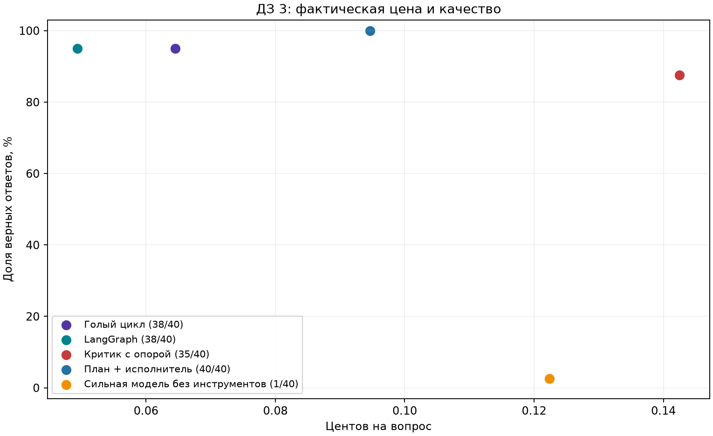

# ДЗ 3: фреймворк, критик и план

Решение для сдачи: ветка `codex/hw3-patterns` репозитория
[`rylengim/models-comparison`](https://github.com/rylengim/models-comparison/tree/codex/hw3-patterns/hw3).

Продолжение агента из ДЗ 1. Сравниваются голый цикл, его перенос на LangGraph,
критик с опорой, отдельный планировщик и сильная модель без инструментов.
Код и данные зафиксированы до основного эксперимента 12 ноября 2026 года.

Сохранённый прогон соответствует версии `5536034`. После ревью исправлены
оценка составных и дробных числительных, владение HTTP-журналом и учёт расходов
при прерывании. Исходный `manifest.json` сохранён; новый код намеренно не
возобновляет старый прогон с другими хэшами. Для новых измерений используйте
отдельный `--out`, для пересчёта сохранённых результатов — `--report`.

## Итоговая таблица

Основной эксперимент завершён: **200 ответов, пять конфигураций по 40 вопросов**. Ниже оценка после одинаковой для всех правки одного ошибочного эталона. Общий расход, включая диагностику, пустые вопросы и демонстрацию лимита: **$0.20497860**.

| Конфигурация | Верно | Доля | Вызовов/вопрос | Токенов/вопрос | ¢/вопрос | ¢/верный |
|---|---:|---:|---:|---:|---:|---:|
| Голый цикл | 38/40 | 95.0% | 2.5 | 4579.45 | 0.0645 | 0.0679 |
| LangGraph | 38/40 | 95.0% | 2.475 | 4493.30 | 0.0494 | 0.0520 |
| Критик с опорой | 35/40 | 87.5% | 5.25 | 11301.08 | 0.1425 | 0.1629 |
| План + исполнитель | 40/40 | 100.0% | 4.125 | 6856.57 | 0.0946 | 0.0946 |
| Сильная модель без инструментов | 1/40 | 2.5% | 1 | 221.05 | 0.1224 | 4.8942 |



Критик в 40 парных сравнениях **исправил 1 ответ и испортил 3**. Его исходные ответы были верны в 37 случаях; итоговые — в 35. Это сравнение внутри одного прогона критика, а не с отдельной базовой линией.

**Вывод 1.** План повысил качество с 38/40 до 40/40 (+5 п.п.), но цена вопроса выросла в 1,92 раза, а цена верного ответа — с 0,0520 до 0,0946 цента. Это прирост качества за дополнительную плату, а не экономия.

**Вывод 2.** Критик оказался дорогой надстройкой без выгоды: 35/40 вместо 38/40 при цене вопроса в 2,88 раза выше. Нулевой токенный налог LangGraph подтверждён побайтовым сравнением; часть экономии в общей строке объясняется кешем провайдера.

Один вопрос меняет результат на 2,5 п.п. Это один прогон на небольшом учебном наборе. Исходный набор HW1 частично отобран по ошибкам сильной модели; её результат без инструментов не следует обобщать на обычные задачи.

[Полный учёт расходов](results/main/expenditure.md) · [Исходные оценки до исправления эталона](results/main/report.md) · [Проверка воспроизводимости](VERIFICATION.md)

## Результаты и материалы

- [Итог после проверки эталона: таблица, график и парный счёт критика](results/main/audited/report.md).
- [Краткий конспект лекций 7–9 и подготовка за 25 минут](LECTURES.md).
- [Проверка данных и оценщика до эксперимента](DATA_AUDIT.md).
- [Выбор 40 вопросов](data/selection.json), [поправки и алиасы](data/audit_corrections.json).
- [Первые HTTP-запросы и налог фреймворка](results/main/framework_probe.json).

## Воспроизведение без API

Из корня репозитория, Python 3.14:

Клиент использует POSIX-блокировку `flock`; проверенная среда — Linux.
Для чистого клона выберите ветку с ДЗ 3:

```bash
git clone --branch codex/hw3-patterns https://github.com/rylengim/models-comparison.git
cd models-comparison
```

```bash
python3 -m venv .venv
source .venv/bin/activate
python -m pip install -r hw3/requirements.txt
python -m pytest tests/test_hw3_*.py -q
python -m hw3.run --report
python -m hw3.audited_report
```

Последние команды пересчитывают исходный и проверенный отчёты из сохранённых реальных ответов и журнала. Исправление ошибочного эталона применяется одинаково ко всем конфигурациям; исходные ответы остаются неизменными.
Ключ не нужен. Установка зависимостей требует сети; пересчёт и тесты — нет.
Три модуля интеграционных тестов прежнего ДЗ требуют `pymilvus`/`milvus_lite` из отдельной среды HW2;
тесты HW3 не пропускаются.

## Новый платный эксперимент

Настройка `OPENROUTER_API_KEY` — в локальном `.env` в корне проекта;
образец — [../.env.example](../.env.example). Ключ не сохраняется в запросах,
трейсах или Git. Используется один `httpx.Client` с response hook.

```bash
python -m hw3.run --out tmp/hw3-repeat --budget-usd 2
# Продолжить тот же прогон при неизменных коде, данных и настройках:
python -m hw3.run --out tmp/hw3-repeat --budget-usd 2 --resume
# Пересчитать его отчёт:
python -m hw3.run --out tmp/hw3-repeat --report
```

Для контролируемой остановки создайте файл `STOP` внутри каталога прогона.
Текущий вопрос будет завершён и сохранён. Для продолжения удалите `STOP`.
Незавершённый HTTP-запрос или неизвестное списание блокируют продолжение до сверки.
Готовые вопросы при `--resume` не вызывают API повторно. Хэши кода, корпуса,
набора вопросов и модели проверяются по `manifest.json`.
Один журнал может быть открыт только одним клиентом: повторный запуск с тем же
журналом завершается с `Ledger already in use`. Владение освобождается при
`close()` или завершении процесса. Служебный `calls.lock` остаётся на диске;
его наличие само по себе не означает активную блокировку. Удалять его для
обхода ошибки нельзя — сначала завершите процесс, владеющий журналом.

## Протокол

**Агент.** Голая базовая линия вызывает прежний `freshqa.agent.run_agent`.
Те же четыре инструмента: `web_search`, `page_find`, `calculator`, `python_exec`.
Промпт, Pydantic-схемы и модель одинаковы у цикла и графа.
Вопрос — единственное поле оценочного набора, которое получает агент.
Ответы, цитаты-эталоны и исторический `agent_ok` в модель не передаются.

**Источники.** Живой пилот столкнулся с HTTP 429 Wikipedia. Его расходы и
частичные ответы сохранены отдельно в `results/online_diagnostic`, с указанием
версии кода `bc828a8`; в основную таблицу они не входят. Основной эксперимент
использует 253 зафиксированных текста из корпуса ДЗ 2 и предоставленного
семинарского снимка. Поиск выполняется BM25, чтение — по полному сохранённому
тексту. Схемы инструментов HW1 сохранены; сетевого fallback нет.
Это адаптация источников прежнего агента, а не сравнение нового движка поиска
с Wikipedia. Все пять конфигураций используют один набор вопросов.

**Выбор вопросов.** Первые 40 записей своего набора HW1, чьи URL присутствуют
в снимке. Правило зависит только от доступности источника, а не от ответа модели.
До основного запуска уточнён вопрос `fresh-13` и объявлены эквивалентные формы
ответов. [Аудит](DATA_AUDIT.md) содержит причины. Выборка не случайная и не
оценивает все типы задач; выводы относятся к этим 40 вопросам и этому снимку.

**Модели.** GPT-4o mini (`openai/gpt-4o-mini`) для цикла, графа и надстроек;
Claude Sonnet 4.6 (`anthropic/claude-sonnet-4.6`) для ориентира без инструментов.
Температура 0, максимум 512 выходных токенов на вызов. Сильная модель отвечает
из памяти — это не оценка Sonnet с поиском. Даже при температуре 0 повторные
генерации могут отличаться.

**Выбор исполнителя.** Из двух полных запусков выбирается большая доля верных,
при равенстве — меньшая фактическая цена. Решение записывается в
`results/main/executor_selection.json`. По исходной оценке обе базы дали 37/40;
после подтверждённой правки эталона обе получают 38/40. Выбор LangGraph не меняется. Оба паттерна используют выбранный цикл.
Выбор и оценка выполнены на одном учебном наборе; независимого test split нет.

## Налог фреймворка

На пустом вопросе «What is 2 + 2?» первые тела HTTP-запросов совпали побайтово:
**661 входной токен у каждого, разница 0**. Описания всех аргументов сохранены.
[Тела, хэши и измерение](results/main/framework_probe.json). Это явный StateGraph
с нашим HTTP-клиентом, а не утверждение о любых настройках LangChain/smolagents.
LangGraph выполняет переходы между узлами и завершение графа, не добавляя токенов.

Фактическая строка LangGraph дешевле, но порядок запусков создаёт эффект кеша:
у второго запроса fresh-0 в bare кешированных токенов 0, в LangGraph — 1920,
при одинаковых 1955 входных токенах. Скидка $0.000144 подтверждена метаданными
провайдера. [Проверка четырёх запросов](results/main/cache_check.json).
Снижение списания нельзя приписывать самому графу; кеш не был отключён.

## Явные состояния и ограничения

- Цикл/граф: модель → инструменты → модель; терминальные состояния — ответ,
  ограничение и ошибка. Последний из шести вызовов резервируется для ответа.
  Повтор одинакового инструмента с теми же аргументами завершает поиск.
- Критик: исходный ответ → вердикт по настоящим результатам инструментов →
  принятие либо исправление. Не более двух исправлений. Вердикт валидируется
  строгой схемой `{supported: bool, issue: str}`. Без опоры ответ не принимается.
  `initial_answer` и `final` принадлежат одному прогону; считаются исправленные
  и испорченные ответы именно этой пары.
- План: отдельный модельный вызов → план в контексте того же исполнителя → ответ.
  Цена планировщика включена в строку конфигурации.
- Общий потолок — 24 HTTP-вызова на исходный вопрос, включая проверяющего,
  планировщика и повторные исполнения. Он не сбрасывается внутри паттерна.
  Автоматических повторов платного запроса нет.
- Учёт HTTP: готов → запрос отмечен `inflight` → стоимость записана → готов.
  Неизвестное списание переводит клиент в блокировку. Маркер и журнал сохраняются
  на диск до продолжения; перезапуск восстанавливает расходы и число вызовов.
  Запись в журнал и обновление баланса в памяти завершаются до снятия блокировки;
  прерванный клиент запрещает новые запросы. Закрытый клиент повторно не используется.
- Прогон: новый → вопрос выполняется → ответ сохранён → следующий вопрос.
  `STOP` завершает работу между вопросами; `--resume` пропускает сохранённые.
  Отдельный этап аудита меняет только оценку, сохраняя исходные ответы.

Перед отправкой резервируется консервативная сумма по размеру запроса и
`max_tokens`; цены провайдера ограничены `provider.max_price`. Фактическая
стоимость берётся только из `usage.cost`. При отсутствии цены клиент останавливается.
Предел нового эксперимента дополнительно уменьшен на расходы исходного пилота,
чтобы сегодняшняя работа укладывалась в согласованные $2.

## Демонстрация программного потолка

На вопросе о дате бойкота закрытия Паралимпиады установлен общий лимит **1** вызов.
Планировщик потратил единственный вызов; исполнитель был остановлен кодом до
следующего HTTP-запроса. Фактически отправлен **1** запрос, итог **`unknown`**,
статус **`budget_exceeded`**, расход **$0.00006180**.
[Полный трейс](results/main/limit_demo.json). Это намеренная проверка границы,
она не включена в строки основного сравнения. Скрипт: `python -m hw3.demo_limit`;
при наличии сохранённого результата он показывает его без нового платного вызова.

## Метрики и проверка проверки

Для N вопросов, K правильных ответов и суммарного списания C долларов:
точность = K/N; вызовы и токены делятся на N; цена вопроса = 100C/N центов;
цена верного ответа = 100C/K, включая стоимость всех неверных ответов.
При K=0 последняя величина не определена, а не равна нулю.

Оценщик выделяет короткий `FINAL`, проверяет даты и числа, поддерживает
объявленные алиасы, числительные и диакритику; явное отрицание и неоднозначные
альтернативы отвергаются. Он остаётся приближением. Полные ответы, ошибки и
исходная опора сохраняются для отдельного просмотра; результаты модели-оценщика
не подменяют эту проверку. Исторические таблицы семинарского ноутбука не
используются как измерения нашего решения.

Выражения с `point`, `half` и `quarter`, включая смешанные формы `5 and a half`,
проверяются как целые фрагменты: их части не участвуют в числовом сравнении.
Остальные числа в ответе доступны для проверки. Такие словесные дроби не
переводятся автоматически в десятичные: для эквивалентности `one point five`
и `1.5` нужен объявленный алиас. Точное текстовое совпадение дроби сохраняется.

## Навигация по коду

| Файл | Назначение |
|---|---|
| `client.py` | HTTP hook, полный журнал, лимиты денег/вызовов и запись незавершённых запросов |
| `agents.py` | Исходный цикл, StateGraph, критик и планировщик |
| `snapshot_tools.py` | Те же схемы инструментов на фиксированных источниках |
| `run.py` | Протокол, сохранение каждого вопроса, возобновление и выбор исполнителя |
| `evaluation.py`, `report.py` | Оценка, контроль сумм, таблица, график и кандидаты аудита |

Официальные описания использованных API:
[StateGraph](https://reference.langchain.com/python/langgraph/graph/state/StateGraph),
[ограничение цены OpenRouter](https://openrouter.ai/docs/guides/routing/provider-selection#max-price).
Для сдачи достаточно ссылки на эту папку в ветке `codex/hw3-patterns`.

## Результат проверки оценщика

Прочитаны **68 полных ответов**: все незачёты четырёх инструментальных конфигураций,
по десять их зачтённых ответов, все четыре изменившиеся пары критика и выбранные
ответы сильной модели. Среди 44 проверенных зачётов ложных положительных нет.
Из 24 проверенных незачётов 20 оказались настоящими отказами, а 4 — проявлениями
одной ошибки эталона `fresh-31`. Назначение Бектенова подтверждено официальным указом;
исходный набор путал премьер-министра с председателем парламента. Исправление
применено ко всем конфигурациям, включая оба ответа критика, без новых генераций.

[Полные ответы, источники и решения AI-аудитора](results/main/manual_audit.md).
Автор проверки — Codex; она не выдаётся за выполненную пользователем.
Исходные данные и ответы сохранены, исправленная оценка отделена в `audited/`.
