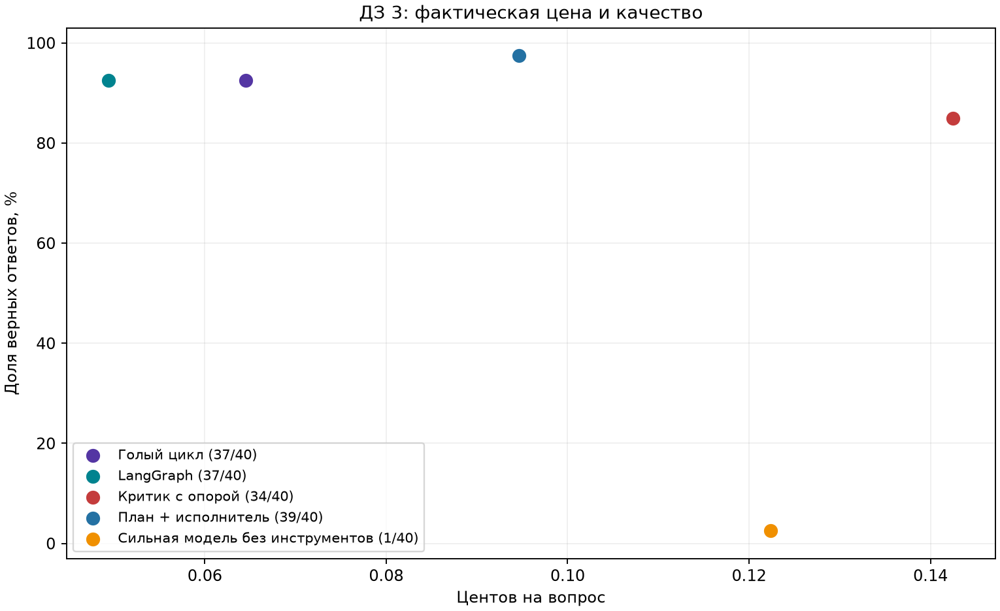

# ДЗ 3: результаты измерений

Таблица пересчитана из сохранённых ответов и HTTP-учёта. Цена включает неверные ответы. `—` означает отсутствие данных или неопределённую метрику; цена верного ответа при нуле верных не равна нулю.

| Конфигурация | Вопросов | Верных | Доля верных | Вызовов/вопрос | Токенов/вопрос | ¢/вопрос | ¢/верный | Состояние |
|---|---:|---:|---:|---:|---:|---:|---:|---|
| Голый цикл | 40/40 | 37 | 92.5% | 2.5 | 4579.45 | 0.0645 | 0.0698 | полный |
| LangGraph | 40/40 | 37 | 92.5% | 2.475 | 4493.3 | 0.0494 | 0.0534 | полный |
| Критик с опорой | 40/40 | 34 | 85.0% | 5.25 | 11301.075 | 0.1425 | 0.1676 | полный |
| План + исполнитель | 40/40 | 39 | 97.5% | 4.125 | 6856.575 | 0.0946 | 0.0971 | полный |
| Сильная модель без инструментов | 40/40 | 1 | 2.5% | 1 | 221.05 | 0.1224 | 4.8942 | полный |

Неполные конфигурации не участвуют в итоговом сравнении и не наносятся на график. Входные и выходные токены отдельно сохранены в `summary.csv`.

## Критик: исправил и испортил

Пар с сохранённым исходным ответом: 40. Исправлено: **1**, испорчено: **3**. Сравниваются исходный и окончательный ответы одного прогона критика. Независимый запуск базовой конфигурации не используется для этого счёта.

## Проверка проверки

Результат ручной проверки: [полные ответы, вердикты и правки](manual_audit.md). После добавления подтверждённых алиасов отчёт пересчитывается из исходных ответов.

Оценщик наследует проверки дат, чисел и явных алиасов из ДЗ 1; нормализует диакритику и отдельные числительные zero–twenty, допускает число без слова people в вопросе how many; отвергает явное отрицание и неразрешённые альтернативы. Это консервативная эвристика, а не понимание смысла; неоднозначные ответы требуют ручного аудита.

## Первый запрос и программный лимит

- [Побайтовое сравнение первого запроса](framework_probe.json).
- [Демонстрация остановки по лимиту](limit_demo.json).

## Выводы

Среди двух исполнений лучшая доля верных у «LangGraph»: 37/40 при 0.0494 ¢/вопрос. При равной точности выбран более дешёвый вариант.
«Критик с опорой»: изменение числа верных -3; цена вопроса 2.8841× от выбранной базы. Прироста качества на этом наборе не получено.
«План + исполнитель»: изменение числа верных +2; цена вопроса 1.9155× от выбранной базы. Есть наблюдаемый прирост; цену одного верного ответа следует сравнивать по таблице.
На 40 вопросах один ответ меняет долю верных на 2,5 п.п.; один прогон не доказывает статистическую устойчивость различий.
