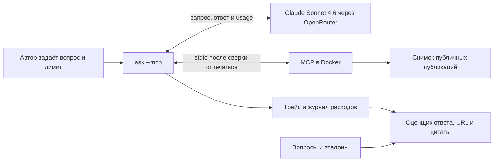

# ДЗ 4 · FreshQA для проверки астрономических фактов

FreshQA помогает автору научно-популярного материала проверять короткие факты из астрономических сообщений 2026 года. Пользователь задаёт вопрос на английском. Агент ищет опору в фиксированном корпусе публикаций обсерваторий и космических агентств и возвращает короткий ответ на английском со ссылкой на публикацию. Успех означает, что ответ совпадает с проверяемым фактом, а ссылка ведёт к тексту, который его подтверждает.

[Сравнение конфигураций](#сравнение-трёх-конфигураций) · [Проверка проверки](#проверка-проверки) · [Отчёт для сдачи](REPORT.md) · [Питч для собеседования](../PITCH.md)

## Запуск одной командой

Нужны Linux, Python 3.12 с `venv` и доступ к локальному Docker с Buildx и Compose. Из корня свежего клона выполните команду.

```bash
python3.12 -m hw4
```

Команда создаёт окружение в `tmp/hw4-mcp-venv`, устанавливает закреплённые зависимости, собирает Docker MCP и задаёт контрольный вопрос `fresh-152` заглушке. Для своего вопроса передайте его в кавычках после `--`. Трейс записывается в `tmp/mcp_answer_trace.json`. Заглушка запускается без `.env` и ключей.

При первом запуске могут понадобиться пакеты из PyPI и закреплённый базовый образ. Для локальной установки из подготовленного каталога wheel-пакетов задайте `FRESHQA_WHEELHOUSE`. В этом режиме базовый образ должен уже быть в локальном Docker.

```bash
FRESHQA_WHEELHOUSE=/path/to/wheels python3.12 -m hw4
```

Этим способом команда проверена в отдельном чистом локальном клоне. Она собрала MCP, вернула цитату про `C/2026 S1 (Euclid)` и ссылку ESA. В трейсе `status=ok`, `model_calls=0` и `cost_usd=0`.

Для запуска с моделью добавьте свой ключ в `.env` и используйте команду с явным денежным лимитом. [Платный запуск одной командой](#ask-через-mcp-с-моделью-openrouter)

## Что делает агент

- Получает вопрос, ищет публикацию и читает нужный фрагмент. При достаточной опоре возвращает один ответ и ссылку на источник.
- Возвращает `unknown`, если в доступных публикациях недостаточно сведений. Ошибка инструмента или исчерпание бюджета фиксируется отдельно в статусе прогона.
- Работает на чтение с публичными источниками. Содержимое публикаций рассматривается как данные. Эталон, проверочная цитата и URL эталона остаются на стороне оценщика.

## Схема



## Набор для оценки

[`data/questions.jsonl`](data/questions.jsonl) содержит 30 англоязычных вопросов. `fresh-125`–`fresh-144` взяты из [авторских дополнений ДЗ 1](../data/additions.jsonl) с исходными вопросами, ответами, ссылками и цитатами. Для `fresh-142` сохранены числовые варианты из [итогового набора ДЗ 1](../data/fresh.jsonl). `fresh-145`–`fresh-154` добавлены для ДЗ 4 по десяти другим официальным публикациям, по одному вопросу на статью.

Каждая строка содержит `id`, `source`, `question`, `answer`, `evidence`, `url`, `event_date` и `checked_at`. Поле `evidence` хранит короткую цитату с дословным ответом. `event_date` обозначает дату публикации результата, указанную в вопросе. `checked_at` хранит дату исходной проверки записи. Допустимые варианты ответа, где они заданы, хранятся в `answer_aliases`.

При оценке сравниваем короткий ответ с эталоном и допустимыми вариантами, а подтверждение ответа источником учитываем отдельно. Режимы MCP используют один снимок корпуса. Все 30 вопросов имеют ответ в источнике. Поведение при отсутствии опоры проверяется отдельно и не входит в точность на этих 30 вопросах.

## Снимок корпуса

[`data/corpus.jsonl`](data/corpus.jsonl) содержит 20 записей из официальных публикаций. В записи хранятся заголовок (`page`), URL, издатель, дата публикации, дата снимка и английский текст (`text`). Текст состоит из краткой аннотации и коротких фрагментов первоисточника. Поля с вопросами и эталонами хранятся отдельно. Это корпус для этого набора задач, поэтому результаты поиска по нему относятся к этим 20 публикациям.

19 ноября 2026 года сверены даты и все 30 фрагментов с официальными страницами. Локально у всех 30 вопросов найден документ с тем же URL и датой публикации, его текст содержит проверочную цитату с эталонным ответом.

## Проверка поиска ДЗ 3

Загрузили корпус через `SnapshotRegistry(corpus_path="hw4/data/corpus.jsonl")`. В `web_search` передали только текст вопроса. В `page_find` передали URL из выдачи и ключевые слова из вопроса. Эталонный URL и цитата использовались для сверки результата. Прогон выполнен локально, без сетевых и модельных вызовов.

| Вопрос | Позиция документа из пяти | Цитата в выдаче и при чтении |
|---|---:|---|
| `fresh-128`, возраст Вселенной в наблюдении SPT2349-56 | 1 | Есть |
| `fresh-134`, инструмент подтверждения WISPIT 2c | 1 | Есть |
| `fresh-152`, обозначение кометы Euclid | 1 | Есть |

Эти три проверки относятся к поиску и чтению источника. Качество ответа модели и задержка приведены в [итоговом отчёте](REPORT.md). Метод `web_search` ДЗ 3 возвращает прежнюю подпись `Wikipedia local snapshot`, хотя издателем служит организация из записи корпуса.

Вопрос `fresh-153` относится к вводному описанию [релиза ESO](https://www.eso.org/public/news/eso2613/), где размер сравнивают с Плутоном. В подробном обсуждении также упоминается Луна. После уточнения вопроса повторная проверка подтвердила покрытие всех 30 вопросов.

## Публикации через MCP

[Сервер](mcp_server.py) запускает тот же поиск ДЗ 3 по снимку в Docker и общается с клиентом через stdio. Контейнер работает без сети, под непривилегированным пользователем, с файловой системой только для чтения. В контекст сборки входят только нужные модули, корпус и список зависимостей.

Из корня репозитория соберите образ и укажите вторую команду в настройках MCP-клиента для запуска через stdio.

```bash
docker compose --env-file /dev/null -f hw4/docker-compose.yml build mcp
docker compose --env-file /dev/null -f hw4/docker-compose.yml run --rm --no-deps -T mcp
```

`web_search` принимает `query` и возвращает до пяти документов с URL и фрагментами. `page_find` принимает URL из выдачи или точный заголовок и необязательные `keywords`. При неизвестном URL возвращает `found: false` и `excerpts: []`. Некорректные аргументы и вызовы инструментов вне списка возвращают ошибку MCP.

Если модель передаёт `page_find.keywords` строкой, клиент разделяет её по пробельным символам, запятым и точкам с запятой и отправляет массив на проверку по схеме MCP. В трейсе сохраняются исходные аргументы модели.

Проверка через MCP-клиент и запущенный Docker-контейнер подтвердила, что на `fresh-128`, `fresh-134` и `fresh-152` нужный источник остался первым из пяти, а точная цитата есть и в выдаче, и в `page_find`. Проверены также неизвестный URL и запрет вызова незарегистрированного инструмента. Образ для проверки собран из локально кешированных пакетов, потому что PyPI был недоступен. Вызовов моделей не было.

## `ask` через MCP с заглушкой

Запуск с пользовательским вопросом использует тот же вход, который подготавливает окружение и образ.

```bash
python3.12 -m hw4 -- \
  'What official designation did ESA report on 19 October 2026 for the first previously unknown comet discovered by Euclid?'
```

Модуль передаёт вопрос в `freshqa ask --mcp`, который открывает сессию с локальным Docker MCP. Заглушка выбирает первый результат `web_search`, читает его через `page_find` и возвращает цитату в `FINAL` со ссылкой `SOURCE` из прочитанного документа. При пустой выдаче команда печатает `FINAL: unknown` без ссылки. Ошибка MCP даёт код выхода 2.

Трейс сохраняется в `tmp/mcp_answer_trace.json` или по пути из `--output`. В нём видны оба вызова инструментов, шаги заглушки и `model_calls: 0`. Сквозной прогон подтвердил цитаты и ссылки на `fresh-128`, `fresh-134` и `fresh-152`. На запросе без совпадений команда вернула `unknown`. Это проверка работы CLI и инструментов. Качество ответов модели измеряется отдельно.

## Лимит на вопрос и расходы за день

В `ask --mcp` один допущенный вызов заглушки стоит условные `$0.001`. Лимит на вопрос по умолчанию составляет `$0.01`. Перед каждым вызовом проверяется, поместится ли он в оставшийся лимит. Если денег на шаг не хватает, команда завершает работу со статусом `budget_exceeded` и кодом выхода 2. Заблокированный вызов не списывает деньги и не запускает инструмент.

Команда выводит сумму за вопрос и за текущие московские сутки. Дневной счётчик сохраняется между запусками в `tmp/mcp_daily_spend.sqlite3`. Для пробного запуска можно указать отдельный файл через `--ledger`.

```bash
tmp/hw4-mcp-venv/bin/python -m freshqa ask --mcp \
  --budget-usd 0.001 --ledger tmp/hw4-budget-smoke.sqlite3 --output tmp/hw4-budget-smoke.json \
  'What official designation did ESA report on 19 October 2026 for the first previously unknown comet discovered by Euclid?'
```

На этом запросе лимит `$0.001` разрешает `web_search` и блокирует следующий шаг до `page_find`. Лимит `$0.003` позволяет пройти все три шага заглушки и вывести цитату со ссылкой. Трейс разделяет условные списания и реальные расходы. В этом режиме `model_calls` и `cost_usd` равны нулю.

## Сокращение контекста

До успешного `page_find` клиент передаёт из `web_search` URL и заголовки всех найденных публикаций в исходном порядке и фрагменты длиной до 200 символов. После успешного чтения в старой выдаче остаются URL прочитанных публикаций. Фрагменты из `page_find` передаются целиком. При ошибке чтения или несовпадении URL клиент сохраняет краткую выдачу со всеми кандидатами.

В `context_steps` трейса записано число символов в ответах инструментов до и после сокращения. `pre_read_compacted_search_results` считает сокращённые выдачи до чтения, `compacted_search_results` считает сокращённые выдачи после чтения. Полные ответы MCP остаются в `events` для проверки цитаты и источника.

В прогоне с MCP на финальном шаге объём ответов инструментов сократился с 5 425 до 1 119 символов для `fresh-128`, с 5 559 до 1 072 для `fresh-134` и с 5 663 до 1 070 для `fresh-152`. Во всех трёх случаях команда сохранила точную цитату и ссылку. Модель не вызывалась.

В проверке `fresh-152` с локальным Docker MCP и HTTP-моками Claude Sonnet 4.6 выдача перед `page_find` сократилась с 2 847 до 1 027 символов. При лимите $0.05 клиент отправил все три запроса в мок, вернул точную цитату и ссылку ESA. Условные расходы по мок-ответам составили $0.014043.

В парном повторе всех 30 трейсов Claude Sonnet 4.6 с MCP менялось только сокращение выдачи. По одному локальному токенизатору средний вход на вопрос уменьшился с **3 029,93 до 2 280,90 токена (−24,72%)**. Ответы модели, результаты инструментов и число запросов были фиксированы. [Метод и результаты](REPORT.md#сокращение-контекста)

## Кэширование префикса промпта

В стабильный префикс входят схемы MCP-инструментов и системное сообщение. На его текстовом блоке стоит `cache_control: {"type": "ephemeral"}` по [формату OpenRouter](https://openrouter.ai/docs/guides/best-practices/prompt-caching#explicit-cache-breakpoints-fine-grained-control). Вопрос и история вызовов остаются после границы кэша. Изменение схемы инструмента меняет отпечаток префикса.

Заглушка помнит префиксы только в пределах одного запуска `ask --mcp`. В трейсе `prompt_cache` хранит отпечаток, `input_tokens`, `cached_tokens` и `cached_input_fraction` по шагам. Общая доля считается как сумма `cached_tokens`, делённая на сумму `input_tokens`. Значения условные, по оценке один токен на четыре байта UTF-8 с округлением вверх отдельно для префикса и оставшегося текста.

На `fresh-152` отпечаток совпал на трёх шагах. Первый шаг прочитал 0 условных токенов из кэша, второй и третий прочитали по 509. Общая доля составила 1 018 из 3 406, или 29,9%. Цитата и ссылка сохранились. При блокировке по бюджету следующий шаг не попадает в статистику кэша. Реальные `model_calls`, `prompt_tokens` и расходы в этом прогоне равны нулю.

По сохранённым списаниям GPT-4o mini прочитал из кэша 1 152 токена на четвёртом шаге `fresh-136`. Для одинаковых запросов через HTTP-мок стоимость всего вопроса составила **$0.00088395 по расчёту без кэша и $0.00079755 по списаниям с кэшем (−9,77%)**. В пересчёте на все 30 вопросов этой серии экономия составила 0,74%. [Метод и результаты](REPORT.md#кэш-промпта)

## Закреплённые контракты MCP

[`mcp_tool_pins.json`](mcp_tool_pins.json) хранит SHA-256 для `web_search` и `page_find`. В каждый отпечаток входят имя, описание, входная и выходная схемы инструмента. Ключи объектов JSON сортируются, порядок элементов массивов сохраняется.

При подключении `ask --mcp` сверяет полученный `tools/list` с эталоном до запуска агента. При расхождении команда указывает изменившийся инструмент и завершает работу с кодом 2. Если закреплённый инструмент отсутствует, дублируется или файл отпечатков недоступен, запуск также прекращается до вызова модели и записи расходов или трейса.

При намеренном изменении контракта сначала проверьте diff описания и схем в `tools/list` доверенной сборки. Затем пересчитайте отпечаток через `tool_fingerprint` и обновите эталон вместе с изменением инструмента. Клиент автоматически эталон не обновляет.

## Накладные токены MCP

Для первого запроса `fresh-152` сравнили два условных входа с одинаковыми системным текстом, вопросом и разметкой кэша. В одном передали обе закреплённые схемы из `tools/list`, в другом схемы отсутствовали (`tools=None`). Обе ветки начинались с пустого кэша.

| Вариант | Условные входные токены |
|---|---:|
| Без схем | 223 |
| С `web_search` и `page_find` | 547 |
| Разница | 324 |

Схемы составили 59,2% входа с инструментами по оценке заглушки в четыре байта UTF-8 на токен. Это замер одного входа. Вызовов моделей и самих инструментов не было.

## Прогон всех 30 вопросов через MCP

После сборки образа MCP и установки зависимостей клиента запустите из корня репозитория:

```bash
tmp/hw4-mcp-venv/bin/python -m hw4.run_mcp_benchmark
```

Скрипт последовательно запускает `ask --mcp` для всех вопросов из `hw4/data/questions.jsonl`. В новый каталог внутри `tmp/` сохраняются `report.md`, `summary.json`, трейсы и отдельный SQLite-счётчик условных расходов. Путь можно задать явно через `--out`; каталог должен быть новым.

Правильность короткого ответа считает оценщик ДЗ 3. Совпадение ссылки и наличие эталонной цитаты в успешном ответе `page_find` проверяются отдельно. Время включает запуск CLI и Docker. Условные токены, шаги и расходы заглушки отделены от фактических вызовов модели и платежей. Технические сбои остаются в знаменателе, а скрипт завершает прогон с ненулевым кодом, если хотя бы один вопрос не удалось обработать.

В проверочном прогоне все 30 команд завершились без сбоев. Для всех 30 вопросов совпал URL и в `page_find` нашлась эталонная цитата. Оценщик зачёл 26 ответов из 30. В `fresh-126`, `fresh-132`, `fresh-136` и `fresh-138` заглушка выбрала другую цитату из подходящей статьи. Среднее время команды составило 4,08 с, условные расходы — $0,09. Реальных вызовов и списаний было 0.

## Проверка проверки

В исходном платном прогоне Claude оценщик зачёл 24 из 30 вопросов. При ручной сверке шести незачтённых случаев нашли **два ложных отклонения**. В `fresh-126` модель правильно назвала RELHIC, в `fresh-154` — 113 дней. Правило для союза `or` сработало на цитате или пояснении. Теперь оценщик извлекает короткий ответ и по-прежнему отклоняет прямые альтернативы в самом ответе. Пересчёт тех же трейсов дал **26/30**. Ещё четыре вопроса завершились с `budget_exceeded` и `FINAL: unknown`.

В живом сравнении вручную проверили все 30 результатов GPT-4o mini с MCP. Подтвердились **28 зачётов и два промаха**, ошибок оценщика в этой серии было **0**.

- `fresh-136`. Нужная публикация ESO была первой в поиске, однако GPT повторил запрос, так и не вызвав `page_find`. Защита остановила повтор, в финале модель вернула `unknown`.
- `fresh-138`. Модель прочитала нужную публикацию и указала верный URL, но в ответе описала экзоспутник. Вопрос был о коричневом карлике, вокруг которого он обращается.

Зачёт с источником требует правильного ответа, совпадения URL и наличия эталонного фрагмента в `page_find`. В отдельной ручной сверке дословно совпали 27 из 30 финальных цитат Claude с MCP. GPT-4o mini обычно давал короткий ответ без отдельной цитаты. Проверка всех 30 результатов заглушки ранее подтвердила 26 зачётов и четыре ошибки выбора фрагмента. [Разбор в отчёте](REPORT.md#реальное-сравнение)

## Пакетный прогон через OpenRouter

`--openrouter` запускает Claude Sonnet 4.6. Задайте `OPENROUTER_API_KEY` в окружении и общий бюджет через `--budget-usd`. В этой команде общий потолок составляет $1.80.

```bash
tmp/hw4-mcp-venv/bin/python -m hw4.run_mcp_benchmark --openrouter --budget-usd 1.80
```

Перед каждым вопросом скрипт берёт меньшую сумму из $0.06 и остатка общего бюджета. Остаток рассчитывается по `spend.jsonl` и передаётся в `ask` с округлением вниз до микродоллара. Если запрос не помещается в уменьшенный лимит или остаток исчерпан, оставшиеся вопросы получают статус `run_budget_exceeded`. При неподтверждённом расходе оставшиеся вопросы получают `accounting_uncertain`. В обоих случаях скрипт сохраняет отчёт и завершает работу с кодом 2.

`report.md` и `summary.json` показывают бюджет, расходы по журналу, входные и выходные токены, чтение и запись кэша, а также качество ответов и пропуски. Счётчики токенов берутся из трейсов, а при неполной телеметрии отчёт показывает покрытие. На HTTP-моках проверены все 30 вопросов и оба сценария остановки.

## Сравнение трёх конфигураций

19 ноября 2026 года все три конфигурации получили одни и те же 30 вопросов в одном порядке. Подтверждённый расход OpenRouter составил $0.48182280 при общем бюджете $1.80 и лимите $0.06 на вопрос. [Итоговый отчёт и происхождение данных](REPORT.md#реальное-сравнение)

| Конфигурация | Верно | Вызовов на задачу | Токенов на задачу | Центов на задачу | Центов за верный ответ | Средняя задержка, с |
| --- | ---: | ---: | ---: | ---: | ---: | ---: |
| Claude Sonnet 4.6 без инструментов | 0/30 (0%) | 1,00 | 230,0 | 0,123330 | — | 2,321 |
| Claude Sonnet 4.6 с MCP | 30/30 (100%) | 3,10 | 3 741,7 | 1,444260 | 1,444260 | 8,768 |
| GPT-4o mini с MCP | 28/30 (93,3%) | 3,40 | 2 267,6 | 0,038486 | 0,041235 | 8,063 |

Токены включают вход и выход. Показатели на задачу рассчитаны по всем 30 вопросам, включая сбой GPT-4o mini. Цена верного ответа учитывает все списания конфигурации. При нуле верных ответов она не определена. Задержка измерена от запуска CLI до завершения и включает запуск Docker в режимах с MCP.

На этом наборе тезис курса подтвердился. GPT-4o mini с MCP дал 28 верных ответов против 0 у Claude без инструментов и обошёлся в 3,20 раза дешевле на задачу. Поиск и чтение публикаций дали модели опору для свежих фактов.

При одинаковых инструментах Claude с MCP дал два дополнительных верных ответа, а цена одного зачтённого ответа была в 35,03 раза выше, чем у GPT-4o mini.

Для платного воспроизведения после подготовки среды задайте `OPENROUTER_API_KEY` в окружении и общий лимит для всех трёх конфигураций.

```bash
tmp/hw4-mcp-venv/bin/python -m hw4.run_mcp_benchmark --compare --budget-usd 1.80
```

Для базового Claude отправляется один запрос на вопрос без схем инструментов. Все конфигурации используют потолок $0.06 на вопрос, ограниченный общим остатком. Скрипт сохраняет отдельный журнал списаний и трейсы для каждой конфигурации. При бюджетной остановке или неподтверждённом списании оставшиеся вопросы отмечаются в сводке.

Сводные `report.md` и `summary.json` содержат точность ответа, вызовы и токены на вопрос, центы на вопрос и за верный ответ, среднюю задержку и статистику `cached_tokens`. Для MCP также указан зачёт с источником по критериям из раздела «Проверка проверки». На моках проверены все 90 запусков и остановка между конфигурациями.

## `ask` через MCP с моделью OpenRouter

Платный режим включается флагом `--openrouter` и требует явного положительного `--budget-usd`. Команда `python3.12 -m hw4 --openrouter` использует `OPENROUTER_API_KEY` из окружения или из `.env`, созданного по [примеру](../.env.example). При прямом запуске `freshqa ask --mcp --openrouter` ключ задаётся в окружении. По умолчанию используется `anthropic/claude-sonnet-4.6`. Флаг `--model` выбирает модель с настроенным потолком цены в [`hw3/model_rates.json`](../hw3/model_rates.json).

Пример платного запуска с подготовкой окружения.

```bash
python3.12 -m hw4 --openrouter --budget-usd 0.06 -- \
  'What official designation did ESA report on 19 October 2026 for the first previously unknown comet discovered by Euclid?'
```

Перед отправкой каждого запроса клиент сравнивает остаток лимита с резервом на вход и максимальный ответ. Для Claude резерв учитывает надбавку за запись кэша. При нехватке остатка команда завершается со статусом `budget_exceeded` и кодом 2. После запроса стоимость берётся из `usage.cost`. Если списание не удалось подтвердить, следующие запросы по этому журналу блокируются до сверки.

Дневные расходы считаются по московской дате из `tmp/mcp_openrouter_spend.jsonl`. Журнал хранит метаданные вызовов. В отдельном трейсе `tmp/mcp_openrouter_trace.json` остаются ответы модели и результаты инструментов. `--ledger` и `--output` позволяют указать другие пути. Ссылка выводится, если такой URL вернул успешный `page_find` с фрагментом текста.

После первого успешного чтения по URL клиент пробует сформировать финальный ответ без инструментов. Модель получает исходный вопрос и прочитанные фрагменты. Клиент принимает ответ, если цитата есть в переданном тексте и `SOURCE` совпадает с URL чтения. При `unknown`, обрыве или неподтверждённой цитате агент продолжает поиск с исходной историей в пределах того же бюджета и лимита шагов. Попытка и её результат видны в `early_final` и `early_final_accepted` в трейсе.

В запросе на финал клиент указывает, что `page_find` уже выполнен, и запрещает имитацию инструментов. Текстовые теги `<tool_call>` и `<tool_response>` приводят к отклонению раннего ответа. Если модель добавила к цитате одну лишнюю точку и остальной текст дословно совпадает с фрагментом, клиент убирает точку из итогового ответа. Исходный текст модели остаётся в трейсе.

На шагах с тем же набором инструментов сохраняются системный префикс и идентификатор сессии. Для Claude системный блок явно помечается `cache_control`, для `openai/gpt-4o-mini` используется автоматическое кэширование. В `prompt_cache` трейс хранит отпечаток префикса и полученные от провайдера `prompt_tokens`, `completion_tokens`, `cached_tokens`, `cache_write_tokens` и `cached_input_fraction`. Когда провайдер опускает счётчик, агрегат для него остаётся `null`. Попадание в кэш зависит от маршрута, модели и длины префикса. [Документация OpenRouter](https://openrouter.ai/docs/guides/best-practices/prompt-caching).

Режим проверен на HTTP-моках. Они подтверждают блокировку запросов по лимиту, стабильность префикса и учёт холодной записи и последующих чтений кэша. В проверке `fresh-152` со строкой `keywords` прошли все три шага при лимите $0.06. Ответ содержал точную цитату и ссылку ESA.

## Безопасность

В этой конфигурации есть две составляющие смертельной тройки. Модель получает недоверенные тексты и обращается к внешнему провайдеру через клиент. Доступ к закрытым данным через инструменты исключён границей корпуса. `web_search` и `page_find` читают только зафиксированные публичные публикации. `page_find` ищет URL в снимке, произвольного выхода в интернет у инструмента нет. Пользовательский вопрос передаётся в OpenRouter, поэтому рабочий сценарий рассчитан на публичные факты.

Единственная модельная роль FreshQA получает `web_search` и `page_find`. Клиент проверяет отпечатки их описаний и схем до вызова модели. Корпус и результаты инструментов считаются данными. Системная инструкция требует игнорировать обращённые к агенту указания внутри них. Для раннего финала инструменты отключаются, клиент проверяет цитату и точный URL. Команды исполнения кода, изменение репозитория и публикация сообщений отсутствуют в разрешённом наборе. Необратимые действия исключены интерфейсом. Человек заранее выбирает режим и денежный лимит.

MCP работает в Docker без сети и без передачи секретов, с файловой системой только для чтения, непривилегированным пользователем и без Linux capabilities. Контекст сборки ограничен списком в [Dockerfile.dockerignore](Dockerfile.dockerignore). `OPENROUTER_API_KEY` нужен клиенту для запросов к модели и передаётся в заголовке `Authorization`. Промпт, аргументы MCP и журнал списаний формируются без ключа. `.env` исключён из Git. В достижимых объектах Git совпадений с проверенными форматами ключей OpenRouter, Groq и OpenAI Project при локальной проверке не найдено.

19 ноября 2026 года проверили ключ из локального `.env` запросом `GET /api/v1/key`. OpenRouter вернул `is_management_key: false` и `is_provisioning_key: false`. Для работы FreshQA достаточно обычного ключа: административные операции с ключами требуют отдельного ключа управления. `limit: null` и `limit_reset: null` означают, что у проверенного ключа индивидуальный потолок расходов и период его сброса не заданы. [Метаданные ключа](https://openrouter.ai/docs/api/api-reference/api-keys/get-current-key) · [Управление ключами](https://openrouter.ai/docs/api/api-reference/api-keys/list) · [Лимит ключа](https://openrouter.ai/docs/api/api-reference/api-keys/update-keys)

Клиент требует явный бюджет на вопрос и ведёт дневной учёт расходов. Пакетное сравнение дополнительно ограничено общим бюджетом прогона. [Локальный контроль расходов](#лимит-на-вопрос-и-расходы-за-день)

## Ограничения сдачи

Фиксированный корпус покрывает 30 заданных вопросов. Объединённая сводка 30/30 включает четыре повторных трейса после изменений агента. В [отчёте](REPORT.md) приведены показатели исходной серии, живое сравнение трёх конфигураций, замеры обвязки и состояние упаковки.
