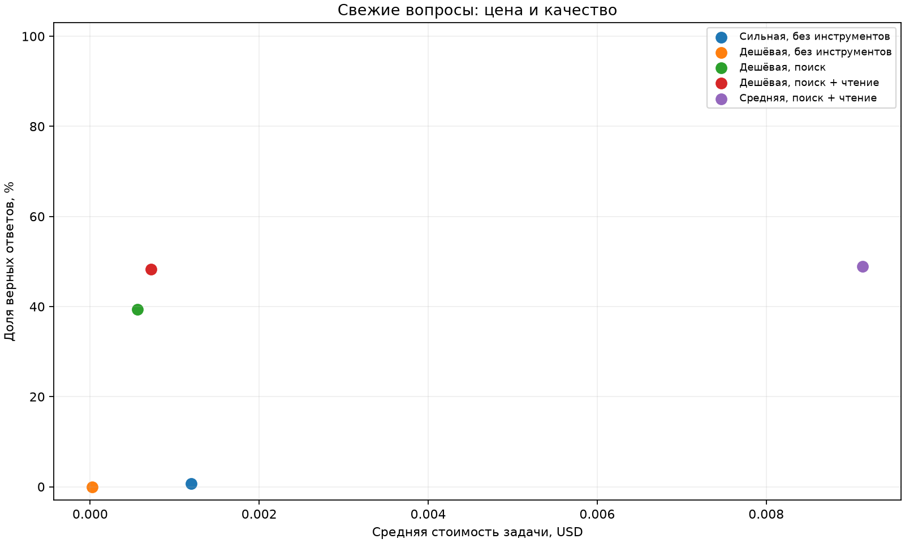

# Результаты эксперимента

Числа рассчитываются только из реальных трейсов. `—` означает отсутствие замера, а не ноль.

| Конфигурация | Завершено | Верных | $/задачу | $/верный | Шагов | Секунд |
|---|---:|---:|---:|---:|---:|---:|
| Сильная, без инструментов | 145/145 | 0.7% | 0.0012 | 0.1736 | 1.0000 | 2.9677 |
| Дешёвая, без инструментов | 145/145 | 0.0% | 0.0000 | — | 1.0000 | 3.4926 |
| Дешёвая, поиск | 145/145 | 39.3% | 0.0006 | 0.0014 | 4.2621 | 13.7147 |
| Дешёвая, поиск + чтение | 145/145 | 48.3% | 0.0007 | 0.0015 | 4.5517 | 13.6164 |
| Средняя, поиск + чтение | 145/145 | 49.0% | 0.0091 | 0.0187 | 3.7172 | 14.0369 |
| Дешёвая, Wiki + второй поиск + чтение | 0/145 | — | — | — | — | — |
| Каскад: дешёвая → средняя | 0/145 | — | — | — | — | — |

Незавершённые строки описывают только обработанные вопросы и не подходят для итогового сравнения.
При нуле верных $/верный не определена. При неизвестном списании цена не рассчитывается.

## Проверка свежести

| Модель | Проверено | Верных | Критерий ≤20% |
|---|---:|---:|---|
| anthropic/claude-sonnet-4.6 | 145/145 | 0.7% | пройден |

Угаданные id: fresh-20.

## Вывод

На этом прогоне тезис подтвердился по критерию «не ниже точность и ниже средняя цена задачи». Дешёвый агент: 48.3%, $0.0007/задачу; сильная без инструментов: 0.7%, $0.0012/задачу. Один прогон не измеряет статистическую устойчивость; причины различий нужно сверить по трейсaм.
